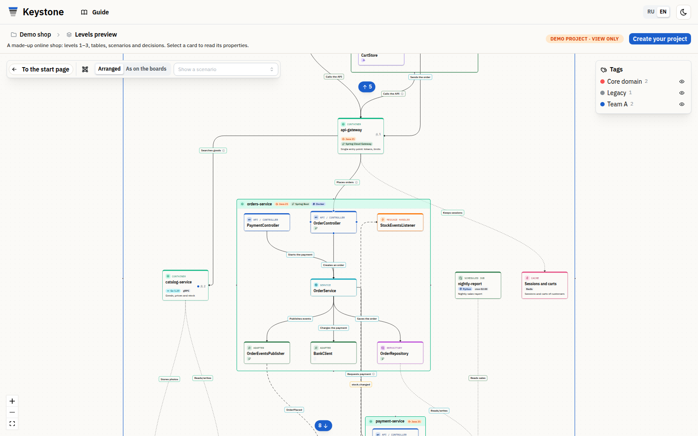

# Keystone

**Understand your system before you change it.**

Keystone keeps a C4 model of your software: systems, services, components with their public API, databases down to
tables and columns, scenarios and architecture decisions. Your AI coding assistant builds the model from the code in
your environment, keeps it in step with the code and reads it back over [MCP](https://modelcontextprotocol.io) as
context for its next task. Every change arrives as a branch that your team reviews.

- Website: **https://keystone-core.pro**
- Live demo, no sign-up: **https://keystone-core.pro/demo**
- Guide: **https://keystone-core.pro/docs**
- MCP server: `https://keystone-core.pro/mcp` (Streamable HTTP, bearer token)

This repository holds no source code: it is the public home of Keystone for its MCP server, docs links and feedback.

<picture>
  <source media="(prefers-color-scheme: dark)" srcset="assets/editor-dark.png">
  
</picture>

## What it does

- **Builds the architecture from code.** Your AI reads the repository where it already works and proposes the model:
  context, containers, components, ER diagrams from migrations. Keystone never receives your source code.
- **Gives the agent the part it needs.** The agent asks for one module, what depends on an element, the path between
  two elements or only what changed since last time, instead of the whole model.
- **Keeps the model current.** After code changes the AI checks the diagram against the code and sends a proposal,
  by hand or from CI: the AI assistant generates the job for GitHub Actions or GitLab CI.
- **You stay the reviewer.** Every AI proposal arrives as a branch: open it, correct it, merge it or reject it.
  Merges are three-way, field by field.
- **More than boxes.** Scenarios, architecture decisions (ADR) bound to elements, impact analysis, antipattern
  review with remediation plans, comments, live co-editing, roles and access, system design interview practice.
- **No lock-in.** Export to PNG, SVG, Markdown with Mermaid, Structurizr DSL and Obsidian notes; import a Structurizr
  workspace (JSON or DSL).

On a question about one module, the module slice took **68–77% fewer input tokens** than sending the whole model,
with the same facts in the answer. This compares a slice with the whole model, not a whole coding task
([method and limits](https://keystone-core.pro/docs/ai-context-study)).

## Claude Code plugin

Install Keystone as a plugin; Claude Code asks for your token once and keeps it in secure storage:

```
/plugin install keystone-architecture --marketplace runafterasun/keystone-core
```

## Connect your AI

1. Sign in at https://keystone-core.pro and open a project → **AI assistant** → **Connection** → **Create token**.
2. Add the MCP server in the folder with the code of that project, or install the plugin above.

**Claude Code**

```bash
claude mcp add --scope local --transport http keystone https://keystone-core.pro/mcp --header "Authorization: Bearer ks_…"
```

**Cursor** (`.cursor/mcp.json`)

```json
{ "mcpServers": { "keystone": { "url": "https://keystone-core.pro/mcp", "headers": { "Authorization": "Bearer ks_…" } } } }
```

**VS Code with GitHub Copilot** (`.vscode/mcp.json`)

```json
{ "servers": { "keystone": { "type": "http", "url": "https://keystone-core.pro/mcp", "headers": { "Authorization": "Bearer ks_…" } } } }
```

**Gemini CLI** (`.gemini/settings.json`)

```json
{ "mcpServers": { "keystone": { "httpUrl": "https://keystone-core.pro/mcp", "headers": { "Authorization": "Bearer ks_…" } } } }
```

**Windsurf** (`~/.codeium/windsurf/mcp_config.json`)

```json
{ "mcpServers": { "keystone": { "serverUrl": "https://keystone-core.pro/mcp", "headers": { "Authorization": "Bearer ks_…" } } } }
```

**Clients with local (stdio) servers only**, through the `mcp-remote` bridge (needs Node.js):

```json
{ "mcpServers": { "keystone": { "command": "npx", "args": ["-y", "mcp-remote", "https://keystone-core.pro/mcp", "--header", "Authorization:${AUTH_HEADER}"], "env": { "AUTH_HEADER": "Bearer ks_…" } } } }
```

A token follows the current role of its owner in the project: a viewer's token only reads. More in the
[guide](https://keystone-core.pro/docs/ai).

## Prompts

Ready commands the server offers to your client, for example in Claude Code `/mcp__keystone__build_architecture <project link>`:

| Prompt | What it does |
|---|---|
| `build_architecture` | Context and containers from the code |
| `build_architecture__full` | The whole architecture: also components and tables |
| `describe_container` | Break a container into components with their public API |
| `describe_database` | Draw the ER diagram of a database from its migrations |
| `describe_scenario` | Trace a scenario through the architecture |
| `record_decision`, `import_decisions` | Record an architecture decision, import existing ADRs |
| `validate_architecture` | Check the diagram against the code |
| `sync` | Bring the diagram up to date with the commits since the last sync |
| `analyze_impact` | What a change of an element affects, with paths and reasons |
| `review_antipatterns`, `plan_remediation` | Find architecture antipatterns, plan their fixes in stages |
| `system_design_interview` | Practise a system design interview on a real diagram |

## Tools

Reading tools return the part of the model a task needs:

| Tool | What it returns |
|---|---|
| `search_architecture` | Elements and tables by name, role or module, with IDs and ready reads for the hits |
| `get_architecture` | The whole model as a short map, one module or chosen elements in full |
| `traverse_architecture` | What depends on an element and what it depends on, to a chosen depth |
| `analyze_impact` | What a change of an element or table affects, with reasons and paths |
| `find_architecture_path` | The chain of calls and data access between two elements |
| `get_architecture_delta` | Only what changed since a version of the model |
| `find_antipattern_candidates` | Shared databases, cycles of synchronous calls, overloaded services |

Changes go through `propose_changes` only: a proposal becomes a branch that a person reviews and merges.
Checks against the code and antipattern findings are reported with `report_validation` and `report_antipatterns`.

## Plans and hosting

- **keystone-core.pro** has a free plan with limits.
- **Self-hosted** inside your own network for companies: [contact us](https://keystone-core.pro/contacts).

## Feedback

Questions, ideas and bug reports are welcome as [issues](https://github.com/runafterasun/keystone-core/issues).
